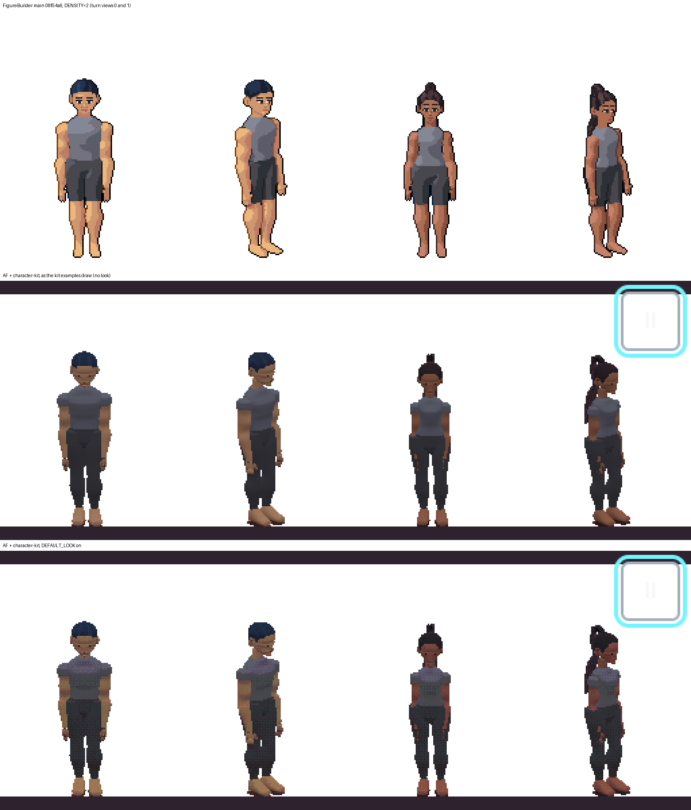
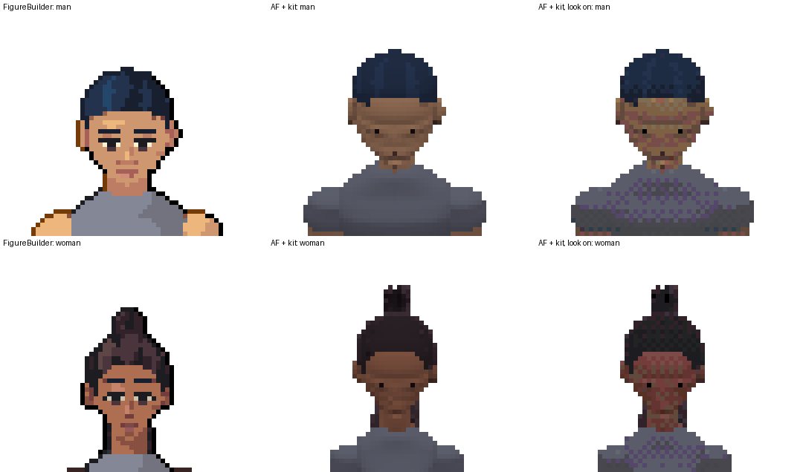
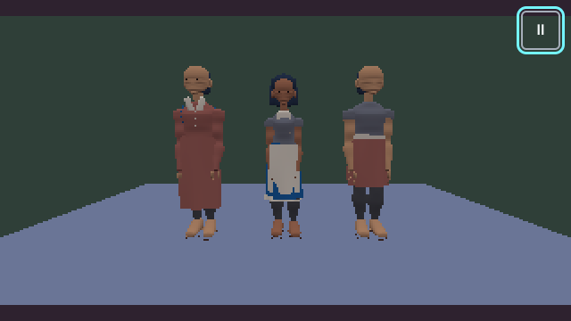
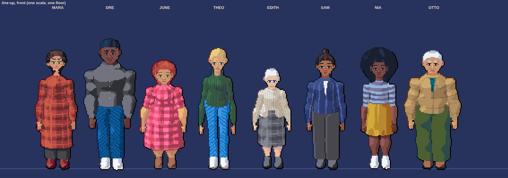
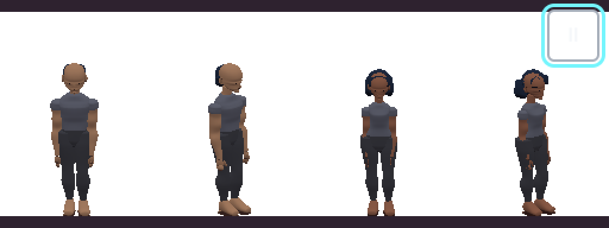

# Why the character kit does not look like FigureBuilder

Phase 1 of the character-kit fix: the causes, ranked, with evidence. No fix is made here.

The Owner, 2026-11-10: the port of FigureBuilder into `extensions/character-kit` "does not match the quality nor look of
our projects … first determine why, then resolve".

**Short answer.** The character kit is not where the look is lost. The kit only adds geometry (garments, hair pieces,
seats); everything a kit figure looks like comes from core's figure view in `packages/3d`. Core left out FigureBuilder's
painter and rasteriser, the part that *is* the look, and replaced it with Phong-lit meshes and three generic post passes
that the kit's examples do not even switch on. On top of that, the data the painter read (hand-picked swatch tones, the
stamped face) was dropped, the base pair the Owner judges by has drifted (bald man, long trousers, painted shoulders), and
the kit's garments and hair come from FigureBuilder `a1f7246` (28 October), three cycles before the `main` it should
match.

## How it was compared

Both sides drew the base pair in the same frame: FigureBuilder's DENSITY=2 cell (128 × 192 texels showing 2.6 m, feet
13.5 texels up, orthographic, 18° down), the front view and the three-quarter view, in the relaxed stand. The man wears
the short fade and the woman the box-braid pony on both sides (AF's from the kit's fixture content).

- FigureBuilder `main` at `08f54a6` (2026-11-10, c5-finish merged): `DENSITY=2 npm run render -- out`, turn views 0 and 1.
- AF at `1e4e2c8f` plus this branch: `examples/3d/diagnosis/diagnosis-base-pair.ts`, a harness written for this (the
  kit's fixture compiled by `extensions/character-kit/scripts/dump-fixture.ts` into the page's `fixture.json`), shot in
  Chromium (SwiftShader WebGL2) at a 512 × 192 viewport, once as the kit's examples draw (no look) and once with
  `?look` (`DEFAULT_LOOK`). Run it with `pnpm examples:3d` and open `/diagnosis/base-pair/`.
- The showcase branches, never merged: `claude/demo-characters` (`demo/out/*`) and `claude/runway-video`
  (`demo/runway/out/contact-sheet.png`, `runway.mp4`).

AF's frame is slightly smaller than 192 rows (the letterbox's bars take a few), so AF's figures sit a little lower and
larger. That does not touch any cause below.

### Side by side

Faces at ×6 (the same rows, cropped):

The kit's own example as it ships (`/characterkit/wardrobe/`): the two men are bald and the faces are smears.

The bar the Owner means (`claude/runway-video`, contact sheet, line-up rows):

Measured on the four-figure row above (distinct RGB colours, white background included): FigureBuilder **33**, AF **811**,
AF with the look **87** (most of them dither pairs).

## The causes, ranked by what they cost the picture

### 1. The painter was left out: AF draws lit meshes, FigureBuilder paints texels

FigureBuilder's look is a CPU painter: the posed parts are rasterised into a supersampled G-buffer (material, part,
group, depth, normal per texel; `src/features/figure/figure.ts:246`, `:390`), resolved down to the cell, then
`paint()` (`src/features/paint/paint.ts:945`, 1,588 lines in that file) decides every texel:

- the painted key light from upper left (`paint.ts:24` `KEY`, a separate `FACE_KEY` at `:26`) cut into each swatch's own
  four hand-picked tones (`tonesOf` `:127`, `familyTones` `:824`, `darkOf` `:818`), not a lighting model;
- an ink outline, inner contour lines and a rim (`OUTLINE`, `LINE`, `RIM` at `:902`, `litLine` `:878`);
- the face stamped in texels (`stampFace` `:246`: brows, whites, iris, lids, nose shade, lips, ears) and the hands
  stamped (`drawHands` `:563`);
- a colour budget of 24 per figure with merges of near tones (`budget` `:668`, `:676`);
- the neckline, cleanup, joint blending and contour smoothing in `raster.ts` (`blendJoins`, `cleanup`, `neckline`,
  `smoothContour`, imported at `figure.ts:6`).

AF took none of it. `docs/provenance/sources.md` records `src/features/paint/paint.ts` and `raster.ts` as "left out: the
figure's CPU painter and rasteriser; the view draws the figure's meshes with Pixi 3D", and with them every test and
golden of the painted pixels. AF's figure view (`packages/3d/src/features/figures/view/figure-view.ts`) draws Phong
meshes under the scene's sky/ground light. That one decision accounts for most of the side-by-side: no outline, smooth
muddy shading instead of three clean bands, 811 colours instead of 33, no face.

This was a recorded decision, not an accident: the 3D slice's D10 (2026-11-07) took the look ("Their pixel-art look
too") but the Owner then said "We use pixi3D", read as "rebuild the look on Pixi 3D, no CPU painter at runtime", and
ADR 0007 chose generic passes. The passes are cause 2.

**Fix it needs:** port the painter and rasteriser faithfully (they are plain TypeScript with no Node imports:
`paint.ts`, `raster.ts`, `row.ts`, `fabric.ts`, `duel-ramps.ts`, `light.ts`, `grade.ts`) and use them to produce the
figure's pixels, held to FigureBuilder's own goldens (`tests/golden/sprites.json`, an md5 per frame). ADR 0007 already
names the route that keeps Pixi 3D as the renderer: (b) *bake*, figure cells drawn as billboards. This reverses ADR
0007's choice for figures (passes), so it is the Owner's call.

### 2. The look passes do not rebuild the look, and the kit's examples do not turn them on

Even where AF tries for the look (`packages/3d/src/features/look/`), it is a different look:

- **The outline is off by default**: `look/library/look.json` has `"switches": { "outline": false, … }`. The one
  thing that makes FigureBuilder's figures read at small sizes is switched off.
- **Dither is on** (`"dither": true`, strength 0.04): the checker pattern on the shirts and faces in the third row.
  FigureBuilder never dithers a figure.
- **The DUEL snap is nearest-of-256 by distance**, not along the swatch's ramp: skin snaps to reds and the hair's
  blue crown to grey (third row, faces crop). FigureBuilder chooses tones per material along its ramp before snapping.
- **The light is five stepped bands of the scene's light**, the same for skin and cloth; FigureBuilder's bands are
  the key light per material, with a separate face key.
- **`spriteLight` is not applied to the figure view** (progress 8.2: "Done in part … `spriteLight` is not applied to the
  figure view yet").
- **Neither kit example sets a look**: `examples/3d/characterkit/characterkit-wardrobe.ts` and `characterkit-hair.ts`
  pass no `look` to `createPixi3dRenderer`, and frame the figures with a perspective camera at 3 m. So the kit is shown
  in plain Phong, which is the row the Owner saw.

**Fix it needs:** once cause 1 is fixed the figure no longer goes through these passes (a baked figure is already
DUEL). Until then, at least outline on and dither off for figures, and the kit's examples drawn with the look.

### 3. The face is two dots, and it does not look at the camera

FigureBuilder stamps a face per view (cause 1) and turns it toward the camera (`face: { camera: 0.6, … }` in
`base/base.ts:17`, read as `lookUp: faceCamera * pitch` in `figure.ts:270`). AF's face is point decals: "an eye each
side … a mouth that shows only when it means something … faces are decals" (`packages/3d/src/features/figures/outfit/garments/face.ts:1`),
and AF's figure has no face-camera share at all (nothing in `figure.schema.ts` or `base-pair.ts`), so the head bows under an 18° camera. The faces crop shows it: no whites,
lids, brows, nose or lips; the head reads as looking at the floor.

**Fix it needs:** the stamped face with the painter (cause 1), and the face's camera share ported with it.

### 4. The swatches lost the painter's tones

FigureBuilder's swatches carry four hand-picked colours and tone offsets (`src/features/outfit/library/swatches.json`:
`"skinWarm": {"ramp":16,"base":5,"paint":["#edb67c","#ce9770","#bd7d64","#a76057"],"tones":[0.55,0.04,-0.5]}`, and
likewise for skin, eyes, whites, lips and hair). AF's swatch is a ramp and a step only, and says so:
"The painter's own fields are not part of this shape" (`packages/3d/src/features/figures/content/swatch.schema.ts:3`).
Without them skin cannot have FigureBuilder's warm light tone and its rosy shadow; it becomes one ramp lit by Phong
(the man's skin goes from FigureBuilder's peach to AF's brown in the side by side). There is also one wrong mapping:
`lips-brown` is `cherry` step 2 in `base-pair.ts`, where FigureBuilder's `lipsBrown` is ramp 19 (`rust`) base 2.

**Fix it needs:** `paint` and `tones` (and `lift`, `white`) back in the swatch schema, and the base pair's swatches
copied from the reference's library, not re-picked.

### 5. The base pair itself has drifted from the reference

The two figures every visual change is judged on are not the same figures:

| What | FigureBuilder `main` | AF | Where |
|---|---|---|---|
| Man's hair | `shortFade` | `cropped`, two locks that sit inside the skull: he renders **bald** (see the kit's wardrobe example, and `?own` in the harness) | `packages/3d/src/features/figures/base/base-pair.ts:40`, `:125` |
| Woman's hair | `boxBraidPony` | a `bob` of six locks | `base-pair.ts:46`, `:165` |
| Lower block | `shorts` (pelvis and thighs) | `trousers` (to the ankle); core has no `shorts` | `base-pair.ts:87`; `outfit/garments/classic.ts:120` |
| Sleeveless top | the shoulder's round stays skin | the shoulder is painted the top's colour (the `a1f7246` rule) | `classic.ts:113` against FigureBuilder `src/features/outfit/garments.ts:161` |
| Feet | bare | shoe-shaped feet in skin | `outfit/garments/hands-feet.ts:1` |

**Fix it needs:** the base pair as FigureBuilder's `base/base.ts` writes it (its hair through the kit, its shorts, the
sleeveless rule), with a golden that compares them.

### 6. The kit's garments are from an older snapshot, rebuilt, and cannot show fabric

- 18 of the kit's source files say they were extracted at `a1f7246` (2026-10-28): every garment (`waistcoat`, `skirt`,
  `apron`, `coat`, `belt`, `mark`, `hang`) and every hair piece but `fall`. Only `fall` and the seats came from
  `025ffb4`. FigureBuilder's `main` is now `08f54a6`, past `025ffb4` by c5-finish (the tile laid over the lit ground,
  `handed`, a dark gloss as leather).
- FigureBuilder's base has no wardrobe since its refactor; the up-to-date wardrobe is the runway branch's
  `demo/runway/wardrobe.ts` (9 kinds and 7 fabrics, registered the way a fork does): each garment is a shell grown from
  the body's own rings (`fit.ts`), skinned to the body's bones, so it clears every slider and holds in the walk. The
  kit's garments are the `a1f7246` hand-sized shapes (a coat is a `tube` from fixed fractions of `k`), so they float or
  cut through on other bodies.
- Fabrics: core took only the registry (`registry/fabric-registry.ts`; sources.md: "the painter that reads the labels is
  not taken"). So no garment can show the runway's plaid, gingham, twill, rib or pinstripe, which carry most of that
  sheet's quality.

**Fix it needs:** port the runway wardrobe's kinds and fabrics into the kit (they are written against FigureBuilder's
public hooks, which core already mirrors), and drop the `a1f7246` shapes. The runway branch is never merged upstream,
so the Owner should say it is the wardrobe they want.

### 7. Missing library data

The kit's fixture has 11 hairstyles; the demo characters also use `sleekPony`, `receding`, `bun`, `shag` and `crop`, and
eye colours (`eyeGreen`, `eyeBlue`) and lips the fixture lacks. Gaits, stands and swatches beyond the base pair's are
fixture-only. Smaller than causes 1 to 6, but the demo characters cannot be drawn in AF until they exist.

**Fix it needs:** the demo characters' `library.ts` and the runway's swatches as kit content.

### 8. Projection and sampling (lowest)

FigureBuilder projects orthographically into the cell, snaps the view to one of 8 directions and the pitch to 2°, and
supersamples (`figure.ts:108`, `:353`). The kit's examples use a perspective camera, so the figure is not one of a
finite set of cells and its pixels swim as it turns. A baked figure (cause 1) brings this with it.

### Checked and not a cause

- **Nearest-neighbour scaling:** AF's letterbox composite target is nearest (`ADR 0007`, "Low-resolution target drawn
  nearest-neighbour: yes"); no smoothing was seen in the shots.
- **Colour space / post-processing of the host:** the examples' page adds none; the colour shift is the snap (cause 2)
  and the missing tones (cause 4).

## Owner's decisions (2026-11-10)

- **The fix: Pixi 3D, FigureBuilder first.** Relayed by the coordinator: "hold off, we're porting to pixi/3d", so
  neither A nor B as written above, nor the quick wins, goes ahead on its own. Then, in this session: "port our
  figurebuilder to pixi3D here", "do it here first, then do it there": FigureBuilder draws its figures in a Pixi 3D
  scene first (FigureBuilder PR #22: the painter's own cell on a quad, 8 directions; 32 were tried and dropped, "let's
  go with 8 directions again"), and that view is then brought into AF.
- **The wardrobe: yes.** The kit takes the runway branch's body-fitted wardrobe and fabrics (`demo/runway/wardrobe.ts`)
  and the demo characters' library (`demo/library.ts`, `demo/runway/library.ts`).

## Recommended approach (for the Owner's call)

**A. Port FigureBuilder's figure pipeline faithfully, and draw its output as baked billboards in Pixi 3D**
(recommended). The generator, rig, rasteriser, painter and figure lighting come over as FigureBuilder wrote them, in
`packages/3d` feature folders, held to FigureBuilder's own goldens (the md5 per frame in `tests/golden/sprites.json`,
the base and lit sheets) bit for bit. AF builds each figure's 8-direction cells (and their normal maps, for
`lightFigure`'s lamps and time of day) and Pixi 3D draws them as billboards, which is ADR 0007's option (b); no CPU
painter draws per frame, but cells are re-baked when an outfit or pose changes. The kit then carries the wardrobe as
FigureBuilder's forks do (runway kinds and fabrics through the hooks) and the hair pieces at `main`.

Stages, each its own branch and draft PR:

1. Port the rasteriser, painter, figure lighting and FigureBuilder's swatch fields; the base pair's golden passes in Node
   and the browsers (L: about 2,800 source lines with `figure.ts` and `cloth.ts`, and their tests).
2. The billboard figure view in Pixi 3D, with the 8-direction snap; base-3d and the 3D examples switch to it; ADR 0007
   amended (M).
3. The base pair and the kit at `main`: hair pieces from `08f54a6`, the runway wardrobe and fabrics, the demo
   characters' library, the base pair as written (M).
4. Before/after renders beside FigureBuilder's for the base pair, the seven demo characters and the runway line-up;
   journeys (S).

Roughly 3 to 4 sessions. It changes the 3D figure goldens and Ember Hall's look (Wick), so the commits say why.

**B. Keep meshes and make the passes closer** (outline on, no dither, ramp-aware snap, per-material bands, stamped
face as a texture, the swatch tones). Smaller (M), but it re-approximates a painter that is already written, will never
match its goldens, and the face and hands cannot be stamped on a mesh at this size without most of the painter anyway.

**Quick wins either way** (S, could land first): the base pair's hair, shorts and sleeveless rule (cause 5); the
`lips-brown` ramp; the kit's examples drawn with the look and outline on.

## Not done here

- FigureBuilder's runway video was looked at frame by frame only through its contact sheet and two stills; the demo
  characters were not drawn in AF (their hairstyles are missing, cause 7).
- Only Chromium (SwiftShader) was used; no WebKit, Firefox or GPU runner.
- No `pnpm check` gate was needed for a document; the harness passed `pnpm typecheck` for `examples/3d` (see the PR).
