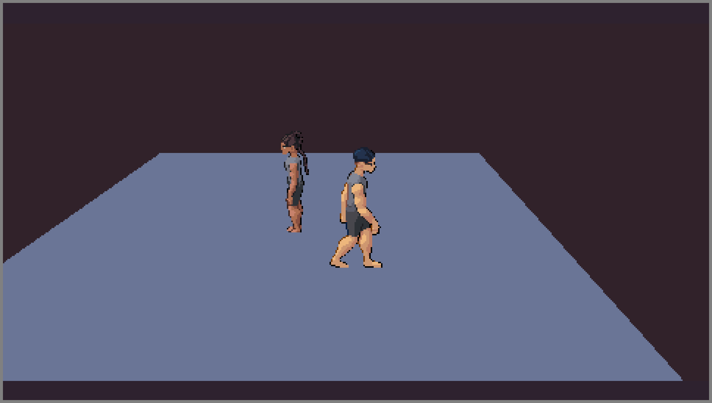
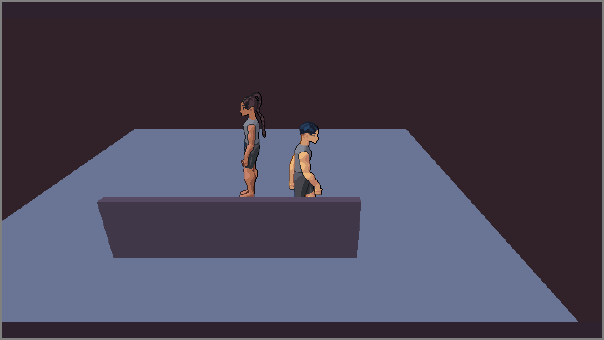
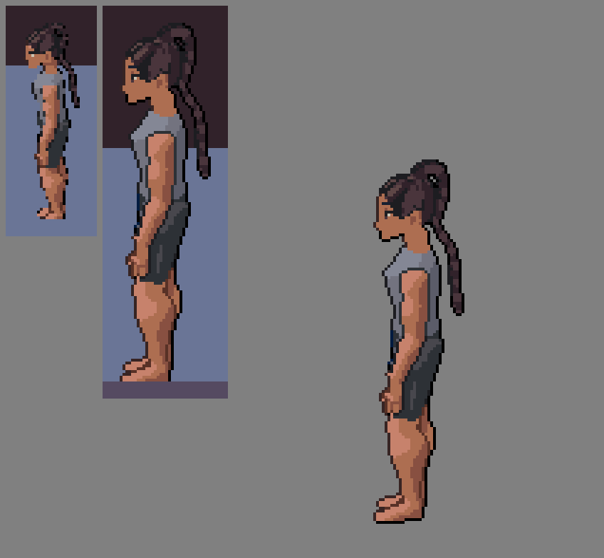

# Gate 1: painted figures at one pixel a texel, with depth

Made by `pnpm --filter @automata/character-kit gate 1` (`extensions/character-kit/scripts/gate.ts`); every number below is in
[`measurements.json`](measurements.json) and [`parity.json`](parity.json), measured from the renders, never typed. The coordinator checks
this before the fashion work (tasks 6 to 8) goes on.

Before is `a66b4e0e` (the head of `claude/figurebuilder-submodule`, which this branch was cut from), built in a worktree of its own;
after is this branch. Both ran in Chromium under Playwright's fake clock with `reducedMotion: 'reduce'`, the viewport the field's own size
so the letterbox's upscale is ×1 and the canvas holds the field's pixels, and the readback taken 33 ms of fake time after the
first frame that shows the figures. That is the walker's loop at the same tick on both sides, but not the stander's idle at the same
step: she is the builder's `Figure` standing idle on the page's frame clock, and how many 17 ms fake-clock steps the page took to
start is not fixed, so the gate finds the idle cell the render shows (below) instead of assuming one.

## The picture

| | field | file |
|---|---|---|
| before | 480 × 270 | [`before.png`](before.png) (×4) |
| after | 720 × 405 | [`after.png`](after.png) (×4) |
| the stander: before, after, the builder's own `standing` cell | | [`stander-before-after-builder.png`](stander-before-after-builder.png) (×4, nearest) |

## Texels a pixel (the stander, the woman, found in each render as the figure farthest from the middle)

| | painted rows of her cell | her height in pixels | texels a pixel |
|---|---|---|---|
| before (480 × 270, cell painted at the camera's 25°), whole figure | 123 | 69 | 1.78 |
| after (720 × 405, cell painted at the painter's 18°), whole figure | 128 | 126 | 1.016 |
| after, from the ground up (the anchor row, 178.5, to her top) | 125 | 125 | 1.000 |

The three rows of her cell under the ground line (128 painted, 125 above it) are the soles' outline, and the room's floor (its top at
the ground) is nearer the camera than they are, so it hides most of them: that is the depth rule at work (the builder's contract, section 4b),
not a painter mismatch. Measured from the ground up the floor does not shorten her, and a texel is exactly a pixel. The before row
measures the whole figure (there is no like-for-like cell to find in a minified render, so no ground is located in it).

Before, a texel was minified: nearly two texels went into each pixel, so texels dropped out (the jagged outline of the left tile).
After, a texel is a pixel: the figure is the builder's cell as it paints it.

### Her cell against the builder's own

She is drawn by the builder's `Figure` standing idle, so the cell the first drawn frame shows is one of the idle's cells, which move
with the figure's own clock (breath, weight shift). The gate compares the render with each of the builder's idle cells (600 steps of
1/60 s from standing still) at the best offset and takes the best, so the comparison is like for like at whatever step the frame
landed on. In `measurements.json` (`after`):

| | texels | share |
|---|---|---|
| opaque texels of the best idle cell (first step: 1, of 4 steps at this share; the sheet's `standing` is step 3) | 2354 | |
| equal to the render's pixel, one pixel each, at the best offset | 2327 | 98.85% |
| of those, below the ground line | 45 | |
| below the ground line, seen | 18 | |
| below the ground line, hidden by the floor | 27 | |
| **above the ground line: equal to the render** | all of them | **100%** |

So the 98.85% is not the painter: every texel above the ground is the builder's to the byte, and the 27 that differ are the soles
under the floor. (The plan's log gave 91% and an earlier version of this README 99%: the render against the sheet's `standing` cell, which is one
idle step, so the number depends on which step the frame landed on. This run's `standing` share, `exactTexelShareVsStanding`, equals
the best.) The unit test `painted-scale` gives the same from `zoomOf`: 0.67 a pixel at 480 × 270,
0.90 at 640 × 360, 1.01 at 720 × 405 (the coordinator's ruling, never minified).

## Parity with the builder's `compose` (the depth sheet)

[`depth-1.png`](depth-1.png) to [`depth-4.png`](depth-4.png): each is the GPU's readback, the builder's `compose(frame, backdrop)` of the same
frame, and red where they differ (the sheets are all dark, so none). Counts, in [`parity.json`](parity.json):

| case | pixels compared | differing |
|---|---|---|
| one figure, orthographic at 18° | 230400 | 0 |
| one figure, perspective (the follow view) | 230400 | 0 |
| two overlapping figures | 230400 | 0 |
| a figure cut by a wall | 228480 | 0 |

Case 3 is two overlapping figures (the nearer in front, the other's body behind her arm); case 4 a figure cut by a thin wall whose front face
is 5 cm in front of the figure's root plane, so some of her stands in front of the wall and the rest behind it, by texel (a pixel either side
of the cut line, 3 rows of 640, is not compared, where two surfaces cross). The same cases run as tests in `tests/browser/painted/painted-depth.test.ts`, which a
flat-depth mutation fails (cases 3 and 4).

## What changed, and why

- The cell is painted at the builder's 18° whatever the camera's tilt (the camera is 25° down here), at D2, and drawn crisp: whole pixels a
  texel, the top-left on the pixel grid. The size is 720 × 405 so that a texel at the walker's feet is 1.01 px.
- Each texel has a depth, so figures hide behind AF's geometry and each other by texel. `characterkit-painted` gained a low wall between the camera
  and the walker's near side (the camera looks toward +z): in `after.png` the walker's legs are behind it.
- The sprite is the builder's own `CellSprite` in AF's `View3D`, placed by the stage contract's rule (the kit's `place.ts`, held to the
  builder's `stageFrame` by a unit test, perspective and orthographic).

## What ran, and what did not

- Ran (Chromium, this container's software WebGL): the gate, `pnpm --filter @automata/character-kit gate 1`.
- Ran (Chromium and WebKit 26.6, this container): the kit's browser suite (3 files, 46 tests, 2 skipped: WebGPU has no adapter here, and
  the gate-sheet case runs only under the gate), and `characterkit-painted`'s journey.
- Not run: Firefox (headless Firefox has no WebGL here), the WebGPU case, the GPU runner: pending for CI.
