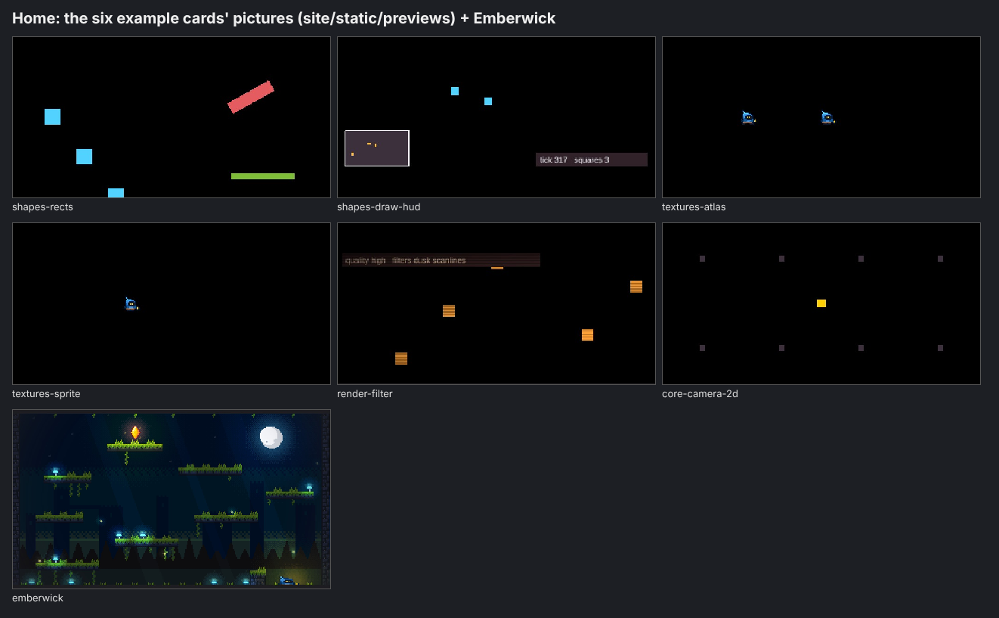
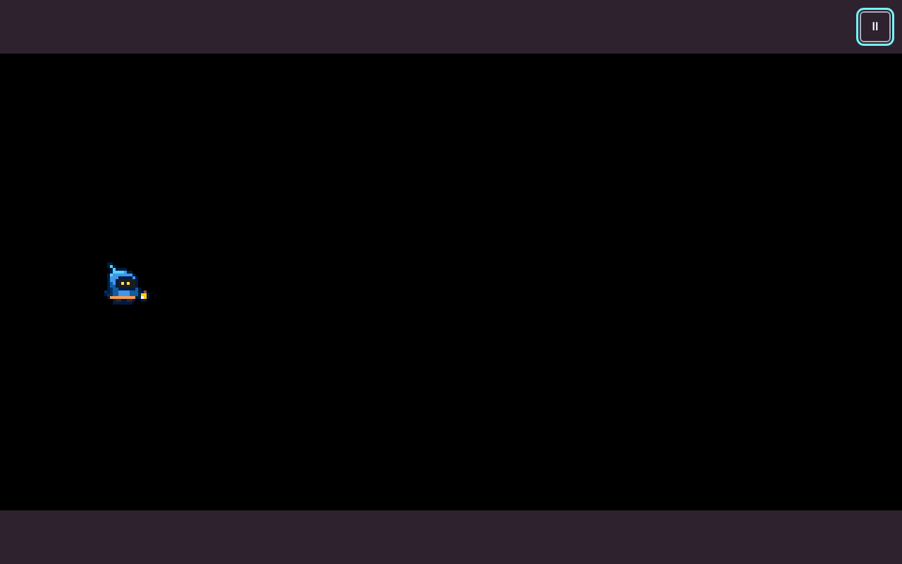
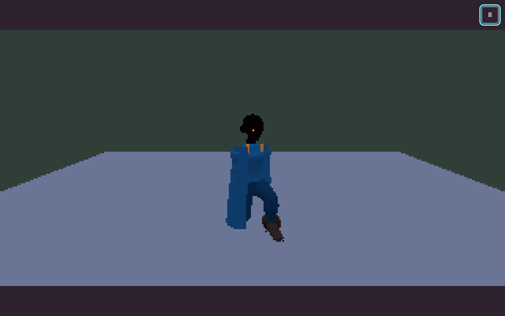
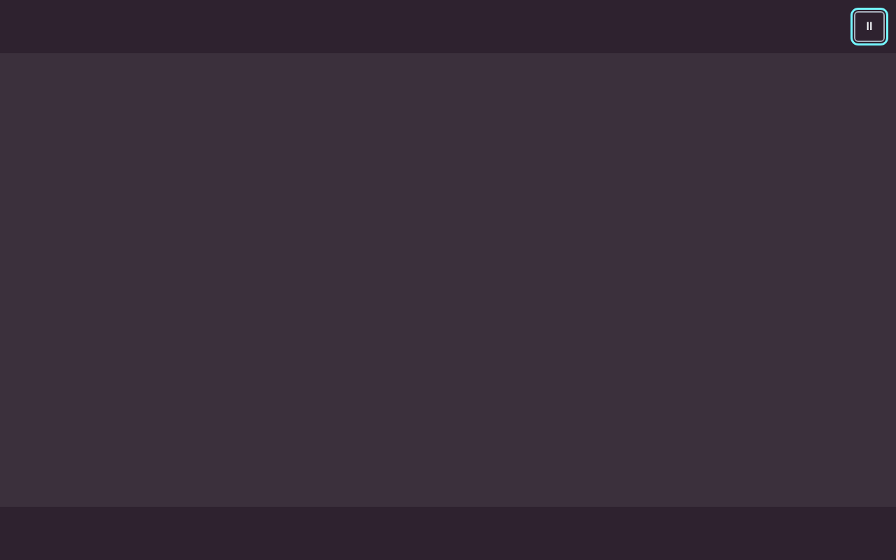
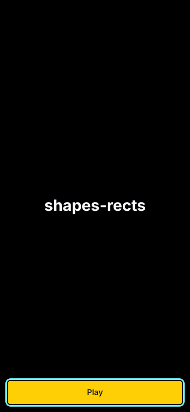
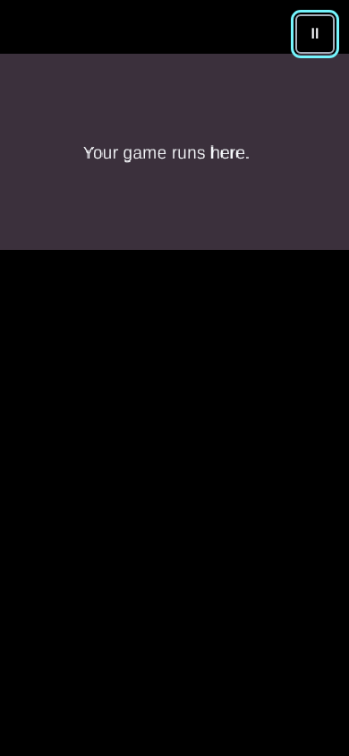

# The examples, as a stranger sees them: a look audit

> **Unfinished: stopped on the Owner's word ("stop the examples", relayed by the coordinator, 2026-11-13).** The 2D
> section and the worst offenders are written from frames I looked at; the 3D frames stop at `lcdpanel-screen` (12 of 22
> shot), the site pages at 18 of 30, the stories were not shot, and the sections marked PENDING were never written. The
> verdict's counts are a draft. The coordinator's later ruling for 3D (one environment and one cast made for the examples,
> not the reference game's prologue) was received and not yet worked into a proposal.

2026-11-13. Audit only: no product code changed. Every frame named here was shot in Chromium (Playwright, headless,
software WebGL for 3D) from a fresh build of `main` at `7b6ce6ace` (see "How it was shot"), at phone (390 × 844) and desktop
(1280 × 800), device scale 1, after the example said `data-state="ready"`, Play was pressed and the example ran for a few
seconds (driven as its header's `Controls:` say where it needs input). Each frame was opened and looked at before a word
was written about it. Frames: [`2026-11-13-examples-look/`](2026-11-13-examples-look/). Contact sheets for the Owner:
[`2026-11-13-examples-look/sheets/`](2026-11-13-examples-look/sheets/).

## Verdict

The Owner is right: the examples look like test fixtures. There are 47 things a stranger can reach (21 one-file 2D
examples, 2 small 2D demos, 22 one-file 3D examples, the 2D and 3D story examples), and Emberwick on the home page.

| Grade | Count | Which |
|---|---|---|
| KEEP as is | 2 | Emberwick (the home demo), `ui/primitives` (a developer page, not a game: keep, but off the examples list) |
| POLISH | 5 | `core-first-run`, `core-input-rebind`, `ui-splash-credits`, `content/hot-reload`, `core-host-lifecycle` |
| REDO | 16 | 2D: `shapes-rects`, `shapes-draw-hud`, `textures-atlas`, `textures-sprite`, `render-filter`, `core-camera-2d`, `core-input-keys`, `core-saves`, `core-leaderboard`, `audio-sound`, `render-interpolation`; 3D: see the 3D table (REDO rows); stories: `2d-story`, `3d-story` |
| CUT (merged into another) | 21 | 2D: `core-basic-window`, `core-input-gamepad`, `core-input-touch`, `core-languages`, `audio-ui-sounds`, `render-quality`; 3D: see the 3D table (CUT rows) |
| MISSING | 7 | 2D: a whole small game (score, lose, win) in one file; tiles and a level from a file in the example list; feel (shake, particles); 3D: interaction (pick up, use), nav and AI, talking (narrative), saving in 3D |

Counts by row are in the tables below; the 3D rows are counted there (the 3D numbers above are filled from them).

What is wrong, in one paragraph: every 2D example is a black field with one to five flat coloured squares, drawn at
320 × 180 and stretched, with HUD text at about 7 px on a phone; its title screen shows the file's id (`shapes-rects`)
in a system font over black, with a yellow Play bar the width of the screen. The six examples the home page shows
directly under Emberwick are exactly these black frames, so the page's best picture is followed by its six worst. The 3D
examples stand an old procedural Wick (a black head with one yellow pixel for an eye) or the painted base pair on an
untextured lilac slab against a flat green wall: no photo surface, no prop from the world kit, no lit room. Thirty-odd
looks, no shared art: the 2D set uses neither Emberwick's tiles nor its font; the 3D set uses neither the world kit's
38 photo surfaces nor the runway cast. On a phone held upright, every fixed-size example sits in a strip at the top with
two thirds of the screen black.

What is right: the site's own design (v2: dark, one lime accent, good type) is clean and its example page works on a
phone (preview first, then code); the framework's UI kit (the pause sheet, the language picker, the save slots) is
legible and consistent; Emberwick looks like a game; the painter's density-2 base pair and the runway cast are good
enough to ship; the world kit has the photo surfaces and props the 3D set needs. The material is all here. The examples
never use it.

## The worst offenders

1. **The home page's six example cards** (`site/static/previews/example-*.jpg`, `HOME_EXAMPLES` in
   `site/src/features/home/home-content.ts`): `shapes-rects`, `shapes-draw-hud`, `textures-atlas`, `textures-sprite`,
   `render-filter`, `core-camera-2d`. Black, empty, a few squares; the sprite is a 16-pixel Wick lost in black.
   They are the first examples anyone sees.
   
2. **`textures-sprite` and `textures-atlas`**: the one 2D character the framework has (Wick, Emberwick's hero) drawn at
   about 60 px on a 1280 px screen and 8 px on a phone, alone on black.
   
3. **The 3D figure examples on the lilac slab** (`figures-poses`, `figures-aim`, `figures-clips`, `figures-walk`,
   `figures-outfits-items`, `figures-stand-and-sliders`): the old procedural Wick, a black head with one yellow pixel,
   in a shapeless blue coat. Nothing like the density-2 look the Owner chose.
   
4. **`audio-ui-sounds`, `core-languages`, `core-basic-window` after Play**: a flat purple field and nothing to press;
   the example's buttons are inside the pause menu, which a stranger never opens.
   
5. **Every title screen**: the id in kebab case (`core-input-gamepad`) over black and a full-width yellow Play.
   It is the framework's default title screen, so this one fix lifts all 43.
   
6. **Phone portrait, every fixed-size example**: the 320 × 180 field is a strip under the pause button and the rest of
   the screen is black; the 3D ones the same.
   

(3D worst frames beside these are in the 3D section.)

## Inventory

Where a stranger reaches each one:

- **Site home** (`/`): Emberwick, framed and playable (hero); six example cards with recorded pictures
  (`site/static/previews/`), in `HOME_EXAMPLES` order. The first three a desktop visitor sees are `shapes-rects`,
  `shapes-draw-hud`, `textures-atlas`; on a phone the cards stack, the same order.
- **Site `/examples`**: the 2D catalog only, by group ("The basics" first: `core-basic-window`, `core-camera-2d`,
  `core-first-run` are the first three cards), text-only cards (no picture). `/examples/<id>`: one page per 2D example,
  the code beside a running preview in the playground (21 pages). `/demos/emberwick`, `/demos/hot-reload`,
  `/demos/primitives` are served too.
- **Not on the site**: all 22 3D examples, `3d/wardrobe`, `2d-story`, `3d-story`
  (`site/src/shared/framework/examples.ts`: "the 3D examples … never reach the site while the 3D packages are private").
- **Run locally**: `pnpm examples` (2D index), `pnpm examples:3d` (3D index), each story's `pnpm dev`.
- **README links**: `examples/README.md` lists 34 rows and misses 8 3D examples (`characterkit-*`, `cutscenes-*`,
  `lcdpanel-screen`, `retrocrisp-grade`, `worldkit-*`); the repository README links `examples/README.md`.
- **The new-game template** (`packages/tools/src/shared/create-game/`) links no example.
- **Tests**: every 2D example has the catalog smoke test (`examples/2d/tests/e2e/examples.test.ts`: boots under the
  fake host, no console error, at Pixel 7 and 780 × 270); 12 have their own journey; 10 have a hash golden
  (`examples/2d/__goldens__/*.replay`). Every 3D example has its own journey (`examples/3d/tests/e2e/`), which checks
  colour counts per third, not a picture. **No example has a recorded picture test**; the six home pictures are static
  JPEGs nobody checks. The stories have one journey each (the Schematic edit-and-play journey), which saves screenshots as
  outputs but compares none.

## 2D, one file each (`examples/2d`)

All at 320 × 180 (a few draw to the window). Frames: `2026-11-13-examples-look/2d/<id>-<phone|desktop>-<1-title|2-play|3-more>.png`.
"Site": on `/examples` (all are). "Home": one of the six home cards.

| Example | Teaches (its header) | Where | Tests | What a stranger sees | Grade |
|---|---|---|---|---|---|
| `shapes-rects` | Rectangles that move, slide and spin | Site, **Home 1** | smoke, golden | Three blue squares, a red bar spinning, a green bar sliding, on black. A programmer's test | REDO |
| `shapes-draw-hud` | A score line and a mini-map over bouncing squares | Site, **Home 2** | smoke, golden | Two blue squares, a grey box (the map) with yellow dots, "tick 317 squares 3" in 7 px text. Reads as debug output | REDO |
| `textures-atlas` | Pictures cut from one packed image | Site, **Home 3** | smoke, golden | Two 16 px Wicks on black; the atlas itself (the point) is never shown | REDO |
| `textures-sprite` | A character animated from a sheet of frames | Site, Home 4 | smoke, golden | One 16 px Wick, 60 px on desktop, 8 px on a phone, on black | REDO |
| `render-filter` | Two filters over the whole picture, by quality | Site, Home 5 | smoke | Orange squares with scanlines; the keys (1, 2, 3) have no button, so on a phone it cannot be changed | REDO (merge `render-quality` in) |
| `core-camera-2d` | A camera follows a square round a big world | Site, Home 6, `/examples` 2 | smoke | A yellow dot among a grid of dark dots; nothing says the world is bigger | REDO |
| `core-basic-window` | A window with a coloured field and a line of text | Site, `/examples` 1 | smoke | "Your game runs here." on purple; on a phone, a strip | CUT (the new-game template is this) |
| `core-first-run` | A first run asks for a language and warns of flashing | Site, `/examples` 3 | smoke, journey | The framework's language picker in its pixel font: clear on a phone, a 170 px box in the middle of a desktop | POLISH (scale the dialog with the window) |
| `core-host-lifecycle` | The game stops while its tab is hidden | Site | smoke, journey | "tick 219 running" in 7 px and a green square | POLISH (a readable clock, something visibly moving) |
| `core-input-keys` | Move with keys, a controller or touch | Site | smoke, golden | A yellow dot that moves; on the phone shot no touch buttons showed before a touch | REDO (one input example, Wick in a room) |
| `core-input-gamepad` | Move with a controller | Site | smoke, golden | A blue dot | CUT (into `core-input-keys`) |
| `core-input-touch` | Steer by swiping, flick to drop | Site | smoke | A cyan dot | CUT (into `core-input-keys`, as its touch half) |
| `core-input-rebind` | Change a control in Settings | Site | smoke, journey, golden | A green dot; on a phone the on-screen buttons (← → Space F) show, the only example where they do; Settings sheet is clear | POLISH (Wick, the room) |
| `core-languages` | The menus in six languages | Site | smoke, journey | After Play, an empty purple field; the languages are in the pause menu | CUT (into `core-first-run`) |
| `core-leaderboard` | Each run's score, on pause | Site | smoke, journey, golden | A green square; the pause sheet says "Scores aren't available here" outside a host | REDO (inside the small game that has a score) |
| `core-saves` | Three slots, progress kept | Site | smoke, journey, golden | The slot screen is clear and good (framework UI); the play behind it is a square | REDO (Wick's room, embers collected and kept) |
| `render-interpolation` | Smooth movement between steps | Site | smoke | A square with a red tick line; "blend on alpha 0.19" in 7 px | REDO (S: Wick jumping at a slow sim rate, blend on and off) |
| `render-quality` | Switch quality while squares drift | Site | smoke | Orange squares, 7 px status | CUT (into `render-filter`) |
| `audio-sound` | A chime when the game says so | Site | smoke, golden | A yellow rectangle; nothing says to tap | REDO (the chime when Wick takes an ember) |
| `audio-ui-sounds` | Buttons that sound | Site | smoke, journey | An empty purple field; the buttons are in the pause menu | CUT (into `ui-splash-credits`, whose buttons are on screen) |
| `ui-splash-credits` | A studio splash, then a title with Credits | Site | smoke, journey | A splash ("Studio" on a dark tile with a yellow ring), then "Moss Studio" with small Play and Credits in a system font | POLISH (the kit's type and a scene behind) |

The two 2D demos with their own package:

| Demo | Teaches | Where | Grade |
|---|---|---|---|
| `content/hot-reload` | The room is a content file, edited while the game runs | `/demos/hot-reload`, home's built-in section | POLISH (it is Emberwick's room: the best-looking 2D example already; frame it with the edit visible) |
| `ui/primitives` | Every UI primitive at every reference size | `/demos/primitives` | KEEP (a developer gallery, not a game; list it under docs, not examples) |

## 2D story (`examples/2d-story`)

PENDING-2D-STORY

## 3D, one file each (`examples/3d`)

PENDING-3D

## 3D story (`examples/3d-story`)

PENDING-3D-STORY

## The site pages around the examples

PENDING-SITE

## What good looks like here

PENDING-GOOD

## The proposal

PENDING-PROPOSAL

## What I could not shoot, and why

PENDING-NOT-SHOT

## For the tracker

PENDING-TRACKER
